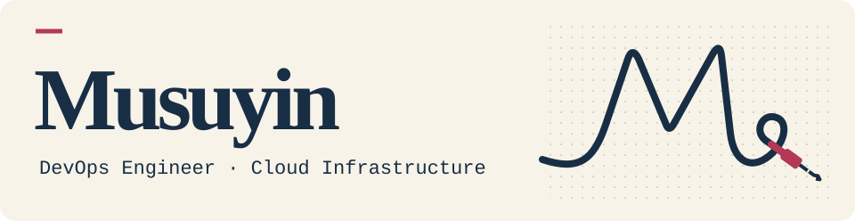

<picture>
  <source media="(prefers-color-scheme: dark)" srcset="./assets/profile-dark.svg">
  
</picture>

My background is in computer science at East China Normal University. I like building tools I can use myself, and I have a soft spot for BanG Dream!

## Selected projects

- [**k8s-pod-monitor**](https://github.com/musuyin/k8s-pod-monitor) — A Go tool for monitoring Kubernetes pods.
- [**so-account**](https://github.com/musuyin/so-account) — A personal finance app for tracking spending and account balances.

**Toolkit**　Go · Linux · MySQL

[Personal blog](https://musuyin.github.io/) · [Bilibili](https://space.bilibili.com/141399783)

---

<picture>
  <source media="(prefers-color-scheme: dark)" srcset="https://raw.githubusercontent.com/musuyin/musuyin/output/github-contribution-grid-snake-dark.svg">
  
</picture>
